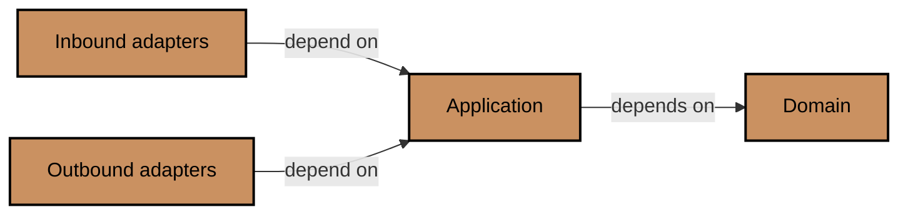

# Layers and the Dependency Rule

| Layer             | Also called       | Purpose                                               |
| ----------------- | ----------------- | ----------------------------------------------------- |
| domain            | core              | business entities and rules, with no external imports |
| application       | use case          | orchestrates the domain and declares ports            |
| inbound adapters  | primary, driving  | translate an external signal into an application call |
| outbound adapters | secondary, driven | implement ports against infrastructure                |

## The Dependency Rule

Arrows show the direction of dependency, not of data. Both kinds of adapter point at the application layer; the
application layer points at the domain; the domain points at nothing. The application layer knows port interfaces, never
an adapter implementation, and no adapter relies on another adapter.

## Domain

**Holds:** entities and aggregate roots, immutable value objects compared by value, domain events, pure domain logic and
invariants, and domain error types.

**Never imports:** a web, command-line, or interface framework; a database driver or object-relational mapper; an HTTP
client; a logging framework; or a network protocol type. It compiles and runs with every adapter absent.

## Application

**Holds:** use-case functions that orchestrate the domain and call outbound ports; inbound port definitions that
adapters call; outbound port definitions for repositories and external services; application error types; and the
command, query, and result objects that cross its boundary.

**Never imports:** a database driver, a framework request or response type, direct filesystem access, or any concrete
infrastructure implementation.

## Outbound Adapters

**Holds:** implementations of outbound ports, such as repositories, caches, and external service clients, together with
their connection setup, query configuration, and mappers.

**Never holds:** business logic or invariant enforcement, which belongs in the domain; inbound adapter code; or
construction of a domain object that bypasses its invariants.

## Inbound Adapters

**Holds:** request handlers and middleware, command handlers and argument parsing, query resolvers, message consumers,
validation of input at the boundary, and the mapping of errors to transport responses.

**Never holds:** business logic, or a call to an outbound port or to infrastructure that bypasses the application layer.

## Errors Cross Once

Domain and application errors carry no transport detail: no HTTP status, no exit code, no terminal message. They become
one in exactly one place, the inbound adapter that received the request.

Mapping earlier puts a transport inside the domain, so the domain changes when a transport does. Mapping in several
places lets two adapters disagree about what the same failure means.
